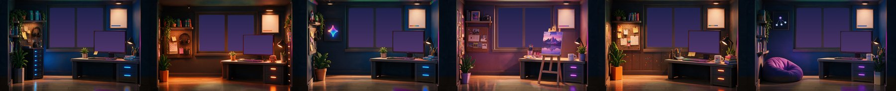
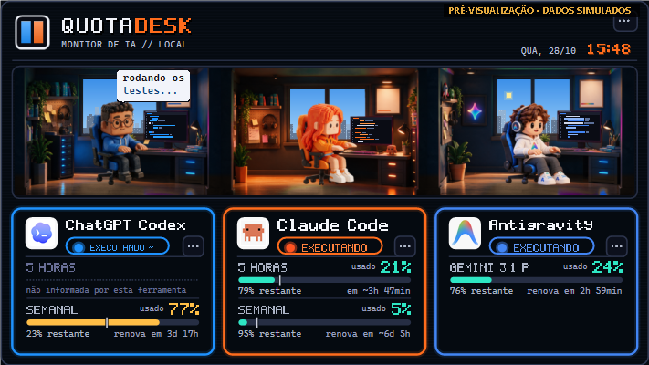
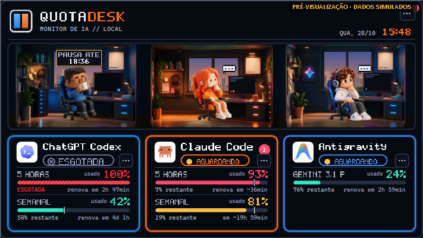
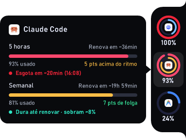
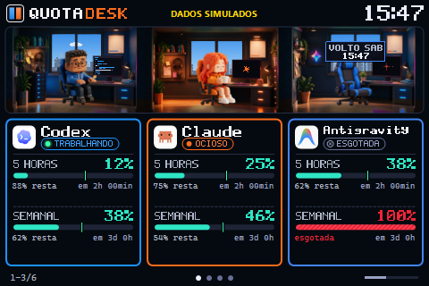
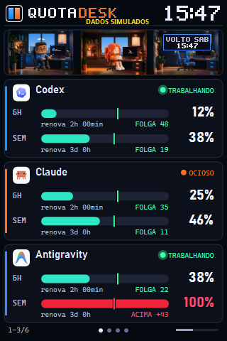
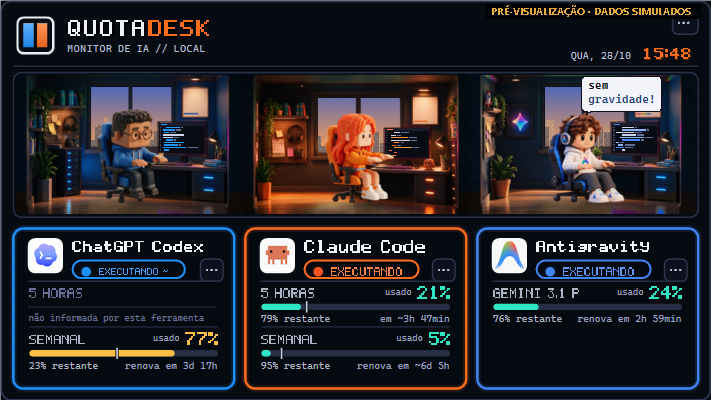
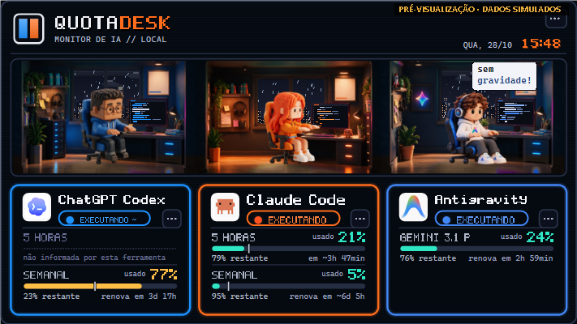
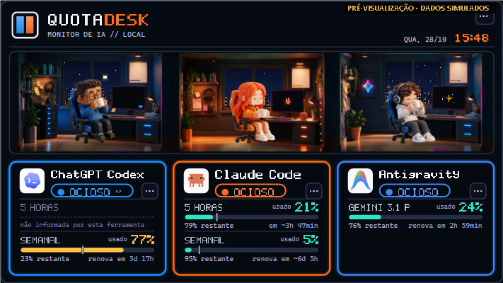
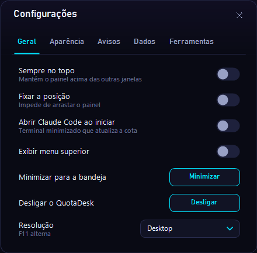

<div align="center">




**Um app de bandeja para Windows que mostra, num escritório voxel animado, quanto resta da cota de cada ferramenta de IA — e se ela está trabalhando, esperando por você ou parada.**



[Site do projeto](https://srbunnie.github.io/QuotaDesk/) · [Instalar](#instalar) · [Casos de uso](#casos-de-uso) · [Adicionar uma ferramenta](#adicionar-uma-ferramenta)

</div>

Cada ferramenta tem uma sala no Loft e um personagem que digita quando ela trabalha, pensa quando espera por você, toma café ou cochila quando está ociosa e procura sinal no celular quando não há leitura. Os cards mostram a cota de 5 horas e a semanal, o ritmo de gasto, quando a cota acaba nesse ritmo e quando renova.

> Todas as imagens desta página usam **dados simulados**.

## Instalar

**Um clique, sem compilar.** Abra o PowerShell e cole:

```powershell
irm https://raw.githubusercontent.com/srbunnie/QuotaDesk/main/install.ps1 | iex
```

Baixa a última versão publicada em [Releases](../../releases/latest), instala em `%LOCALAPPDATA%\Programs\QuotaDesk`, cria atalhos no Menu Iniciar e na Área de Trabalho e abre o painel. Não precisa de administrador nem do .NET instalado. Se preferir, baixe [`QuotaDesk-win-x64.zip`](../../releases/latest/download/QuotaDesk-win-x64.zip), extraia e abra `QuotaDesk.exe`.

**Com o repositório baixado.** Baixe o repositório ([ZIP](../../archive/refs/heads/main.zip) ou `git clone`) e dê dois cliques em **`QuotaDesk.cmd`**. O menu abre e, se ninguém escolher nada em 8 segundos, abre o seu QuotaDesk:

| Opção | Linha de comando | O que faz |
|---|---|---|
| 1 | `QuotaDesk.cmd abrir` | Abre o app instalado. Se ainda não houver um, instala a última versão publicada, sem compilar. |
| 2 | `QuotaDesk.cmd atualizar` | Compara com a última Release e instala se houver versão nova (`reinstalar` instala mesmo assim). |
| 3 | `QuotaDesk.cmd dev` | Compila o código atual e abre o [ambiente de desenvolvimento](#ambientes). |
| 4 | `QuotaDesk.cmd homolog` | Compila o código atual e abre a [homologação](#ambientes). |
| 5 | `QuotaDesk.cmd codigo` | Compila este código e instala na versão pessoal (veja abaixo). |
| 6 | `QuotaDesk.cmd parar` | Fecha o desenvolvimento e a homologação. |

Atualizar ou reinstalar troca só a pasta do programa; preferências, logins e histórico ficam em `%LOCALAPPDATA%\AIUsageMonitor`.

A opção 5 (também `QuotaDesk.cmd -NoInstall` ou `-Package`):

1. procura o SDK do .NET 10 e, se faltar, baixa o instalador oficial da Microsoft, confere a assinatura digital e instala só para o seu usuário;
2. compila, confere se o Windows permite rodar o binário novo, guarda a instalação anterior e instala;
3. cria os atalhos e abre o painel.

O executável não é assinado digitalmente. Na primeira execução o Windows pode mostrar *O Windows protegeu o computador*: clique em **Mais informações › Executar assim mesmo**. Antivírus e Smart App Control podem bloquear compilações novas; nesse caso o instalador para sem mexer na versão instalada.

## O que acompanha

| Ferramenta | Dados | De onde vem |
|---|---|---|
| **Codex** | cotas de 5 horas e semanal, estado | `codex app-server` (`account/rateLimits/read`) e logs locais de sessão |
| **Claude Code** | cotas de 5 horas e semanal, estado em tempo real, pedidos de permissão | statusLine do Claude Code, histórico do app Claude e hooks locais |
| **Antigravity** | cotas por grupo de modelos | servidor local do próprio Antigravity |
| **Magnific** (card Criativos) | saldo de créditos e ritmo de gasto | MCP oficial da Magnific, com login no navegador |
| **OpenRouter** | saldo de créditos e ritmo de gasto | MCP oficial da OpenRouter, com login no navegador |
| **Figma** | disponibilidade global do serviço | página pública de status |

`~` marca valores estimados. Leituras antigas aparecem como desatualizadas e uma fonte que muda de formato vira "sem sinal" — o QuotaDesk nunca inventa um número.

## Casos de uso

**Não estourar a cota no meio de uma tarefa.** A barra de cada card tem uma marca de ritmo: se você está gastando mais rápido do que a janela permite, o card avisa "nesse ritmo a cota acaba ~16:08, antes de renovar". Dá tempo de trocar de ferramenta antes de travar.



**Saber quando um agente está esperando por você.** Quando uma sessão do Claude Code pede permissão ou faz uma pergunta, o personagem fica pensando, o card ganha um selo com o número de pendências e o Windows mostra uma notificação. Com vários terminais abertos, você vê qual precisa de você sem procurar.

**Escolher a ferramenta certa para a próxima tarefa.** Codex sem cota de 5 horas, Claude com folga na semanal, Antigravity com o Gemini livre: o painel mostra tudo lado a lado. Uma cota esgotada vira uma placa "PAUSA ATÉ 18:35" na sala; a semanal esgotada deixa a cadeira vazia com "VOLTO SÁB 15:47".

**Acompanhar créditos pré-pagos.** Para Magnific e OpenRouter, o card mostra o saldo, quanto você gasta por dia e quando o saldo acaba nesse ritmo.

**Ver de relance, sem abrir nada.** O widget de borda fica colado em qualquer canto de qualquer monitor; ao passar o mouse, abre um balão com as cotas, o ritmo e a previsão. O ícone da bandeja tem um medidor por ferramenta.

<p align="center"></p>

**Um painel dedicado numa telinha.** Uma tela USB-C de 3,5" (Turing Smart Screen e clones) ou um monitor pequeno vira um mini painel permanente, que pagina as ferramentas sozinho.

<p align="center">


</p>

**Deixar o escritório bonito o dia todo.** As janelas mostram o céu real da sua cidade (opcional, via Open-Meteo): amanhecer, sol, chuva, tempestade, lua na fase certa.

<p align="center">



</p>

## Configurar cada ferramenta

O passo a passo de cada uma, com o que fazer quando algo não aparece, está em **[tutoriais/conectar-ferramentas.md](tutoriais/conectar-ferramentas.md)**. Em resumo:

- **Codex:** basta ter o Codex CLI ou o app desktop instalado e logado. O executável é procurado em `AI_MONITOR_CODEX_EXE`, no `PATH` e na pasta do app.
- **Claude Code:** a cota exata vem do statusLine, que só roda no Claude Code de terminal. Mescle `claude-settings-additions.template.json` no seu `%USERPROFILE%\.claude\settings.json` (faça backup e troque `{{PASTA_DO_PROJETO}}` pela pasta onde está o `claude-statusline.ps1`: a do app instalado ou `src/QuotaDesk`). Isso liga o statusLine e os hooks do estado em tempo real. Para manter a cota atualizada mesmo usando o app Claude, ative **Configurações › Geral › Abrir Claude Code ao iniciar**.
- **Antigravity:** abra o Antigravity; a cota aparece sozinha enquanto ele está aberto.
- **Magnific e OpenRouter:** **Conectar** no menu da bandeja ou na central, e faça o login no navegador. **Trocar conta…** no card esquece o login atual.
- **Clima (opcional):** menu da bandeja › Cidade do clima.

<p align="center"></p>

## Privacidade e segurança

- Tudo roda na sua máquina. Não envia prompts, não chama modelos e não lê credenciais do Claude nem do Codex.
- O receptor de hooks escuta só em `127.0.0.1:32871` e recusa requisições vindas de páginas web. Do corpo dos hooks usa apenas o id da sessão, o nome da ferramenta, o tipo de notificação e o nome da pasta; nada é gravado.
- O token de sessão do Antigravity fica só em memória. Os logins da Magnific e da OpenRouter são guardados com DPAPI (só o seu usuário do Windows consegue lê-los).
- A rede é usada apenas para os MCPs da Magnific e da OpenRouter, a página de status do Figma e o clima opcional do Open-Meteo (que recebe só latitude e longitude).
- Preferências, caches e o log de erros ficam em `%LOCALAPPDATA%\AIUsageMonitor` (ou na pasta do ambiente, veja [Ambientes](#ambientes)). O log mascara tokens, códigos OAuth e a pasta do usuário.

Falhas de segurança: veja o [SECURITY.md](SECURITY.md).

## Adicionar uma ferramenta

Para agentes de código, o roteiro completo, com as regras do projeto e o esqueleto do adaptador, está no **[AGENTS.md](AGENTS.md#tutorial-adicionar-uma-ferramenta)**. Codex, Cursor e outros leem esse arquivo sozinhos; o Claude Code o recebe pelo `CLAUDE.md`.

A skill [`skills/add-provider`](skills/add-provider/SKILL.md) ensina um agente (Claude Code, Codex…) a colocar uma ferramenta nova de ponta a ponta: o adaptador em C#, a sala no Loft e o personagem com 12 poses. Ela traz os prompts de geração, as regras de chroma-key e os scripts que recortam, alinham e validam a arte:

```bash
python skills/add-provider/scripts/add_room.py --id cursor --room cursor-room.png --seat 182
python skills/add-provider/scripts/cut_poses.py --id cursor --sheet cursor-sheet.png --sheet2 cursor-sheet2.png
python skills/add-provider/scripts/validate_assets.py
```

Para usar no Claude Code, copie a pasta para `.claude/skills/` (ou `~/.claude/skills/`) e peça "adicione o Cursor ao QuotaDesk".

## Estrutura do código

Tudo fica em `src/QuotaDesk` (projeto `AIUsageMonitor.csproj`, assembly `QuotaDesk`). Dependências NuGet: `ModelContextProtocol.Core` e `System.IO.Ports`.

| Arquivos | Papel |
|---|---|
| `Program.cs`, `MonitorContext.cs`, `AppPaths.cs` | entrada, instância única, pasta de dados de cada ambiente, bandeja, timers e ciclo de vida |
| `Models.cs`, `ProviderModule.cs`, `ProviderCategories.cs`, `ProviderPresentation.cs` | contrato `IAgentSource` / `AgentStatus`, catálogo de provedores, ordem e visibilidade |
| `*Agent.cs`, `CodexClient.cs`, `ClaudeIntegration.cs`, `ClaudeQuota.cs`, `OpenRouterMcpClient.cs`, `OpenRouterTokenCache.cs`, `CreditUsage.cs` | leitura de cada ferramenta |
| `RenewalWatcher.cs` | avisos de renovação e `AppSettings` (`settings.json`) |
| `MonitorForm*.cs`, `SettingsForm.cs`, `LauncherForm.cs`, `DockForm.cs`, `NotchForm.cs`, `MiniScreen.cs`, `SerialMiniScreen.cs`, `UsbSerialScreen.cs` | janelas e superfícies |
| `SharedOfficeScene.cs`, `ClassicOffice.cs`, `PixelOffice.cs`, `OfficeViewport.cs`, `SkyService.cs`, `Theme.cs`, `PixelFont.cs`, `TrayIconRenderer.cs`, `LucideIcons.cs` | cena, céu, cores e desenho |
| `*Checks.cs`, `LoftReview.cs`, `MiniOfficePreview.cs` | autotestes e prévias |
| `build.ps1`, `install-shortcuts.ps1`, `claude-statusline.ps1` | build, atalhos e integração com o Claude Code |

### Autotestes

Usam dados simulados e preferências isoladas:

```powershell
QuotaDesk.exe --selftest-stability <pasta>
QuotaDesk.exe --selftest-office <pasta>
QuotaDesk.exe --selftest-office-navigation <pasta>
QuotaDesk.exe --selftest-claude <arquivo.txt>
QuotaDesk.exe --preview <pasta>      # painel, céus, widget e bandeja com dados simulados
```

### Ambientes

O app instalado é o seu QuotaDesk de uso diário: `%LOCALAPPDATA%\Programs\QuotaDesk`, com dados em `%LOCALAPPDATA%\AIUsageMonitor`. Para desenvolver sem arriscar esses dados, abra o código atual num ambiente isolado, que roda ao lado dele:

```powershell
scripts\env.ps1 dev                  # dados vazios, nada real
scripts\env.ps1 homolog              # cópia dos seus dados reais (sem os logins), para testar a versão candidata
scripts\env.ps1 homolog -FreshData   # recopia os dados pessoais
scripts\env.ps1 dev -Stop            # fecha o ambiente
```

Cada ambiente tem programa, pasta de dados (`AIUsageMonitor-dev`, `AIUsageMonitor-homolog`) e trava de instância única próprios, e aparece na bandeja como `QuotaDesk [dev]` ou `QuotaDesk [homolog]`. Eles nunca alteram a inicialização com o Windows. A cota do Claude vem do mesmo cache do statusLine, só para leitura. O estado ao vivo dos hooks continua com a versão instalada.

Para qualquer build, `QUOTADESK_DATA_DIR=<pasta>` escolhe a pasta de dados, e `--test-instance` sozinho usa `AIUsageMonitor-Test`.

Fluxo sugerido: `feature/*` → `scripts\env.ps1 dev` → branch `release/x.y` → alguns dias em `homolog` → merge na `main`, tag e Release → a versão pessoal se atualiza pelo `install.ps1`. Branches de trabalho ficam locais. O que for particular (notas, rascunhos de arte) vai para um repositório privado, nunca para uma branch deste: uma branch enviada aqui fica pública.

## Contribuir

Issues e pull requests são bem-vindos. Antes de abrir um PR, rode os autotestes e ative os hooks que barram chaves e dados pessoais:

```powershell
git config core.hooksPath .githooks
```

Nunca anexe `settings.json`, arquivos `*.dat`, o `error.log` ou capturas com dados da sua conta. As regras completas estão em [SECURITY.md](SECURITY.md#regras-do-repositório).

## Créditos e licença

- **Autores:** o QuotaDesk é uma parceria entre [@edirsooo](https://github.com/edirsooo), de quem veio a ideia original e que colabora com ideias e código, e [@srbunnie](https://github.com/srbunnie), que deu continuidade ao projeto. O lançamento é dos dois.
- **Código:** licença [MIT](LICENSE).
- **Arte:** todas as ilustrações do app — as salas do Loft, os personagens e suas poses — foram geradas com IA no Magnific por [@edirsooo](https://github.com/edirsooo) e são de **livre uso pessoal**.
- **Ícones:** [Lucide](https://lucide.dev) (ISC), em `src/QuotaDesk/assets/lucide`.
- **Marcas:** os nomes e logos de Claude, Codex/ChatGPT, Antigravity, Figma, Magnific e OpenRouter pertencem a seus donos e aparecem só para identificar cada serviço. O QuotaDesk é independente e não é afiliado a nenhum deles.
